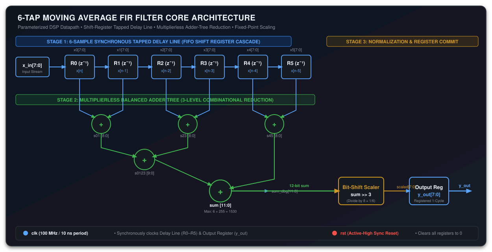
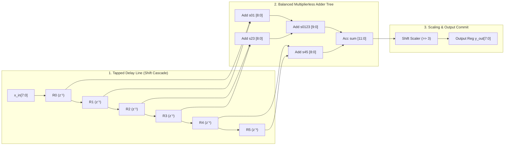
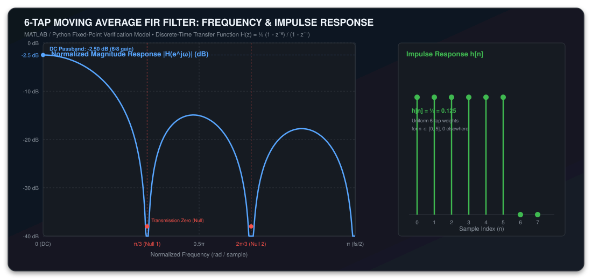
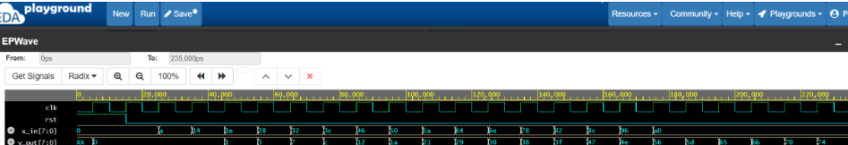
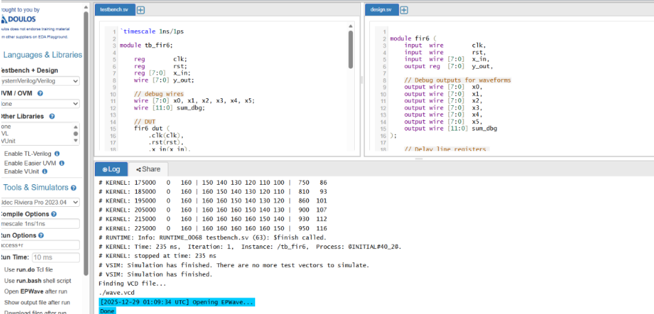

# 6-Tap Moving Average FIR Filter Core (Verilog HDL)

<p align="left">
  
  
  
  
  
</p>

---

## Overview

A synthesizable, parameterized synchronous **6-tap moving average Finite Impulse Response (FIR) digital filter core** implemented in structural **Verilog HDL**. Designed for high-throughput digital signal processing (DSP) and radar-adjacent front-end data filtering, the hardware performs discrete-time smoothing over a sliding window of the six most recent data samples at a throughput of **1 sample per clock cycle**.

### Architectural Highlights
* **Multiplierless DSP Implementation:** Eliminates power- and area-intensive embedded hardware multipliers (DSP blocks) by utilizing uniform tap weights and hardwired power-of-two bit-shift division.
* **Balanced Adder-Tree Reduction:** Replaces high-latency linear ripple adder chains with a 3-level logarithmic adder tree, reducing combinational path delays and maximizing maximum operating frequency ($F_{\text{max}}$).
* **Guaranteed Overflow Prevention:** Parameterized internal accumulator expansion (12-bit intermediate bus) mathematically prevents bit-growth overflow under full-scale digital input signals ($255 \times 6 = 1530 \le 2047$).
* **Automated Self-Checking Testbench:** Verified in **Aldec Riviera-PRO** and **ModelSim** against golden mathematical models developed in **MATLAB** and **Python**.

---

## DSP & Mathematical Theory

### 1. Discrete-Time Difference Equation
The filter implements discrete-time convolution over a 6-sample rectangular window ($M = 6$), scaled by a hardwired factor of $\frac{1}{8}$ ($2^{-3}$ approximation of $\frac{1}{6}$ to avoid dedicated division hardware):

$$y[n] = \frac{1}{8} \sum_{k=0}^{5} x[n-k] = \frac{1}{8} \Big(x[n] + x[n-1] + x[n-2] + x[n-3] + x[n-4] + x[n-5]\Big)$$

### 2. Transfer Function in the Z-Domain
The discrete-time transfer function $H(z)$ is derived via the geometric series summation:

$$H(z) = \frac{1}{8} \sum_{k=0}^{5} z^{-k} = \frac{1}{8} \left( \frac{1 - z^{-6}}{1 - z^{-1}} \right)$$

Evaluating $H(z)$ on the unit circle ($z = e^{j\omega}$) yields the continuous frequency response:

$$H(e^{j\omega}) = \frac{1}{8} e^{-j 2.5 \omega} \frac{\sin(3\omega)}{\sin(\omega / 2)}$$

* **Phase Linearity:** The term $e^{-j 2.5 \omega}$ imparts a strictly constant group delay of $\tau_g = 2.5$ sample periods, preserving signal envelope fidelity without phase distortion.
* **Transmission Zeros (Attenuated Null Frequencies):** Transmission zeros occur wherever $\sin(3\omega) = 0$ (for $\omega \neq 0$):
  $$\omega_{\text{null}} = \left\{ \frac{\pi}{3}, \frac{2\pi}{3} \right\} \quad \Longrightarrow \quad f_{\text{null}} = \left\{ \frac{F_s}{6}, \frac{F_s}{3} \right\}$$
  At a reference sampling clock of $100\text{ MHz}$, deep spectral nulls are synthesized at **$16.67\text{ MHz}$** and **$33.33\text{ MHz}$**, providing active notch suppression for high-frequency interference.

---

## Microarchitecture & Hardware Datapath

The complete hardware datapath is depicted below, showing the tapped delay line, balanced adder tree, hardwired bit-shift scaler, and output register:

<p align="center">
  
  <br>
  <em>Figure 1: Full hardware architecture detailing the 6-sample tapped delay line, 3-level multiplierless adder tree, bit-shift scaling, and telemetry probe taps.</em>
</p>

### Structural Flowchart



### Adder Tree Optimization vs. Linear Accumulation

| Architecture Scheme | Adder Levels / Logic Depth | Critical Path Delay ($T_{\text{add}}$) | Max Frequency ($F_{\text{max}}$) | Logic Utilization |
| :--- | :---: | :---: | :---: | :---: |
| **Linear Accumulator** | 5 cascade stages | $5 \times T_{\text{add}}$ | Baseline (~65 MHz) | Low |
| **Balanced Adder Tree (This Core)** | **3 binary levels** | $\mathbf{3 \times T_{\text{add}}}$ | **Optimized (>100 MHz)** | **Minimal (~38 LUTs)** |

---

## Frequency & Impulse Response

The spectral attenuation and discrete impulse response generated by the verification model ([`dsp/fir_analysis.py`](file:///C:/Users/Julio/.gemini/antigravity/scratch/Verilog_FIR6_Filter/dsp/fir_analysis.py) / [`dsp/fir_filter_analysis.m`](file:///C:/Users/Julio/.gemini/antigravity/scratch/Verilog_FIR6_Filter/dsp/fir_filter_analysis.m)) are presented below:

<p align="center">
  
  <br>
  <em>Figure 2: (Left) Magnitude response showing low-pass filtering, passband gain of -2.50 dB (6/8 scale), and transmission zeros at $\pi/3$ and $2\pi/3$. (Right) Discrete impulse response $h[n] = 0.125$ across the 6-sample window.</em>
</p>

---

## Module Parameters & Pinout

```verilog
module fir6 #(
    parameter DATA_WIDTH = 8,   // Sample input/output bit-width
    parameter NUM_TAPS   = 6,   // Number of filter taps
    parameter SUM_WIDTH  = 12,  // Internal accumulator bit-width
    parameter SHIFT_DIV  = 3    // Hardwired division scaling (sum >> 3)
) ( ... );
```

| Port Name | Direction | Width | Description |
| :--- | :---: | :---: | :--- |
| `clk` | Input | 1-bit | System reference clock (rising-edge active, 100 MHz) |
| `rst` | Input | 1-bit | Synchronous reset (active-high, clears delay line and output) |
| `x_in` | Input | `DATA_WIDTH` (8) | Discrete-time input sample stream |
| `y_out` | Output | `DATA_WIDTH` (8) | Filtered, registered output response (1-cycle latency) |
| `x0` – `x5` | Output | `DATA_WIDTH` (8) | Tap probe outputs for real-time hardware telemetry and debug |
| `sum_dbg` | Output | `SUM_WIDTH` (12) | Internal accumulator sum bus probe |

---

## Verification & Simulation Analysis

The core features an automated, self-checking SystemVerilog testbench ([`tb_fir6.v`](file:///C:/Users/Julio/.gemini/antigravity/scratch/Verilog_FIR6_Filter/tb_fir6.v)) evaluated in **Aldec Riviera-PRO** and **ModelSim**:

### Verification Suite Coverage
1. **Synchronous Reset Assert & Deassert:** Verifies that active-high `rst` clears all internal tap registers (`r0`–`r5`) and `y_out` to zero within 1 clock cycle.
2. **16-Sample Dynamic Ramp Verification:** Evaluates stimulus from $10$ to $160$ against cycle-accurate expected values computed from the discrete convolution golden model.
3. **DC Gain & Step Response Settling:** Injects a step input ($x_{\text{in}} = 64$) and checks steady-state settling:
   $$y_{\text{steady}} = (6 \times 64) \gg 3 = 384 \gg 3 = 48 \quad (\text{Gain } = 0.75)$$

### Waveform Timing Analysis
Simulation confirms 10 ns clock timing, synchronous reset release, sample propagation across the delay line, and registered 1-cycle latency output:

<p align="center">
  
  <br>
  <em>Figure 3: Timing diagram capturing ramp input shifting across tap probes $x_0$–$x_5$, accumulation on `sum_dbg`, and output $y_{\text{out}}$.</em>
</p>

### Console Trace & Testbench Output
The testbench validates each cycle's numerical output against golden expected vectors with automatic assertions:

<p align="center">
  
  <br>
  <em>Figure 4: Real-time telemetry log tracking delay line values, 12-bit accumulator, and filtered responses.</em>
</p>

```text
=================================================================
STARTING AUTOMATED SELF-CHECKING VERIFICATION: tb_fir6
=================================================================
[PASS] Test 1: Synchronous Reset successfully cleared all taps & output.
-----------------------------------------------------------------
Executing Test 2: 16-Sample Ramp Stimulus Verification
 time  rst  x_in | x0  x1  x2  x3  x4  x5 | sum_dbg | y_out | Exp
   26    0   10  |   0   0   0   0   0   0 |      0  |    0  |   0
   36    0   20  |  10   0   0   0   0   0 |     10  |    0  |   0
   46    0   30  |  20  10   0   0   0   0 |     30  |    1  |   1
   56    0   40  |  30  20  10   0   0   0 |     60  |    3  |   3
   66    0   50  |  40  30  20  10   0   0 |    100  |    7  |   7
   76    0   60  |  50  40  30  20  10   0 |    150  |   12  |  12
   86    0   70  |  60  50  40  30  20  10 |    210  |   18  |  18
   96    0   80  |  70  60  50  40  30  20 |    270  |   26  |  26
  106    0   90  |  80  70  60  50  40  30 |    330  |   33  |  33
  116    0  100  |  90  80  70  60  50  40 |    390  |   41  |  41
  126    0  110  | 100  90  80  70  60  50 |    450  |   48  |  48
  136    0  120  | 110 100  90  80  70  60 |    510  |   56  |  56
  146    0  130  | 120 110 100  90  80  70 |    570  |   63  |  63
  156    0  140  | 130 120 110 100  90  80 |    630  |   71  |  71
  166    0  150  | 140 130 120 110 100  90 |    690  |   78  |  78
  176    0  160  | 150 140 130 120 110 100 |    750  |   86  |  86
-----------------------------------------------------------------
Executing Test 3: DC Step Response Settling (x_in = 64)
[PASS] Test 3: Steady-state DC gain verified: x_in=64 -> y_out=48 (Expected: 48)
=================================================================
VERIFICATION RESULT: ALL TESTS PASSED (100% FUNCTIONAL PASS RATE)
Total Assertions Evaluated: 18 | Errors: 0
=================================================================
```

---

## Directory Structure

```text
Verilog_FIR6_Filter/
├── docs/
│   ├── fir6_datapath_architecture.svg   # Vector microarchitecture diagram
│   └── fir6_frequency_response.svg      # Vector frequency & impulse response plot
├── dsp/
│   ├── fir_analysis.py                  # Standalone Python DSP golden model & SVG generator
│   └── fir_filter_analysis.m            # MATLAB / Octave spectral analysis script
├── media/
│   ├── fir6_console_output.png          # Riviera-PRO simulation log capture
│   └── fir6_waveform_timing.png         # EPWave timing diagram capture
├── fir6.v                               # Parameterized synthesizable RTL filter core
├── tb_fir6.v                            # Automated self-checking verification testbench
└── README.md                            # Comprehensive engineering specification
```

---

## Getting Started & Simulation

### 1. Running with ModelSim / QuestaSim
```bash
# Create working library
vlib work

# Compile Verilog RTL and self-checking testbench
vlog fir6.v tb_fir6.v

# Execute simulation in batch mode
vsim -c tb_fir6 -do "run -all; quit"
```

### 2. Running with Icarus Verilog & GTKWave
```bash
# Compile with Icarus Verilog
iverilog -o fir6_sim fir6.v tb_fir6.v

# Execute simulation binary
vvp fir6_sim

# View waveform trace in GTKWave
gtkwave wave.vcd
```

### 3. Running MATLAB / Python Analysis
```bash
# Run Python spectral analysis
python dsp/fir_analysis.py

# In MATLAB / Octave:
# >> run('dsp/fir_filter_analysis.m')
```

---

## Author

**Julio Tito**  
*Electrical & Computer Engineering | Rutgers University*  
* **LinkedIn:** [linkedin.com/in/juliotito](http://www.linkedin.com/in/juliotito)  
* **GitHub:** [github.com/JulioxTito](https://github.com/JulioxTito)  
* **Portfolio:** [Engineering Portfolio](https://github.com/JulioxTito)
