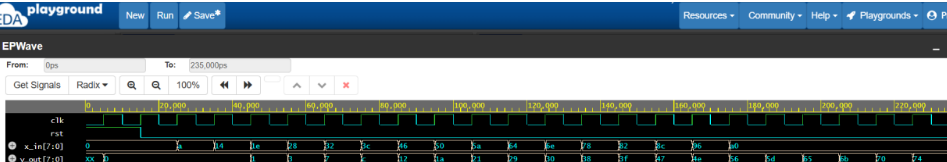
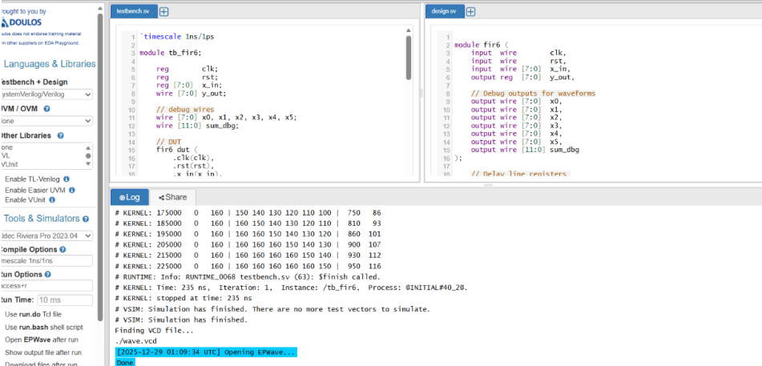

# 6-Tap Moving Average FIR Filter (Verilog HDL)

## Overview

A parameterizable, synchronous 6-tap moving average Finite Impulse Response (FIR) filter core modeled in structural Verilog. The hardware implements discrete-time smoothing over a sliding window of the six most recent 8-bit unsigned data samples. By leveraging uniform tap coefficients and hardwired bit-shift division, the architecture eliminates dedicated hardware multipliers to minimize silicon area and optimize logic utilization.

---

## Architectural Implementation

### 1. Shift Register Delay Line
Incoming discrete-time samples (`x_in`, 8-bit unsigned) pass through a 6-stage tapped delay line (`r0` to `r5`) clocked on the rising edge. The register cascade acts as a sliding FIFO memory buffer containing the current sample and previous 5 historical samples:

$$x[n], x[n-1], x[n-2], x[n-3], x[n-4], x[n-5]$$

### 2. Multiplierless Accumulation Tree
Because the design implements an unweighted moving average filter ($h[k] = 1$), tap products simplify into direct parallel accumulation:

$$\text{sum}[n] = \sum_{k=0}^{5} x[n-k] = r_0 + r_1 + r_2 + r_3 + r_4 + r_5$$

- **Bit-Growth Precision:** For 8-bit unsigned inputs ($0 \le x_i \le 255$), the maximum theoretical sum is $6 \times 255 = 1530$. The internal accumulator bus is zero-extended to 12 bits (`wire [11:0] sum`), preventing arithmetic overflow.

### 3. Power-of-Two Scaling
To normalize the moving sum without an area-intensive iterative division unit, the accumulator sum is scaled via a hardwired right-shift by 3:

$$y_{\text{scaled}} = \text{sum} \gg 3 \quad \left(\approx \frac{\text{sum}}{8}\right)$$

The final filtered result is registered into `y_out[7:0]` on the subsequent clock edge.

---

## Module Ports & Interface

| Port Name | Direction | Width | Description |
| :--- | :--- | :--- | :--- |
| `clk` | Input | 1-bit | System clock (rising-edge active) |
| `rst` | Input | 1-bit | Synchronous reset (active-high) |
| `x_in` | Input | 8-bit | Discrete input sample bus |
| `y_out` | Output | 8-bit | Filtered, registered output response |
| `x0` – `x5` | Output | 8-bit | Tap probe outputs for waveform debugging |
| `sum_dbg` | Output | 12-bit | Internal accumulator probe bus |

---

## Verification & Simulation

Functional verification was conducted using the self-checking testbench (`tb_fir6.v`) with Aldec Riviera-PRO and EPWave on EDA Playground:

- **Clock & Reset:** 100 MHz reference clock (10 ns period) with active-high synchronous reset held across 2 cycles.
- **Ramp Stimulus:** Applies a 16-sample ramp vector ($10, 20, 30, \dots, 160$) to verify delay-line shifting, accumulation accuracy, and output settling over time.
- **Real-Time Tracing:** Implements `$monitor` for console logging and `$dumpvars` for VCD waveform generation.

### Waveform Timing Analysis
The waveform confirms 10 ns clock timing, synchronous reset release, input sample propagation across the delay line, and the registered 1-cycle latency filtered output:

  

### Console Trace & Bus Inspection
Simulation execution log verifying tap register shifts ($x_0$–$x_5$), the 12-bit accumulator sum, and scaled 8-bit outputs:

  

---
